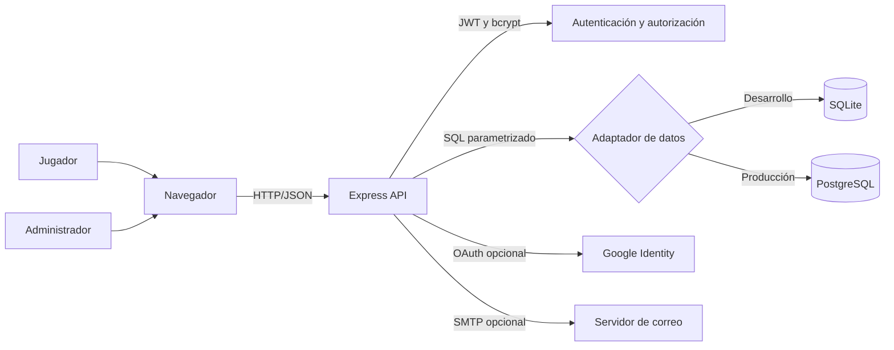
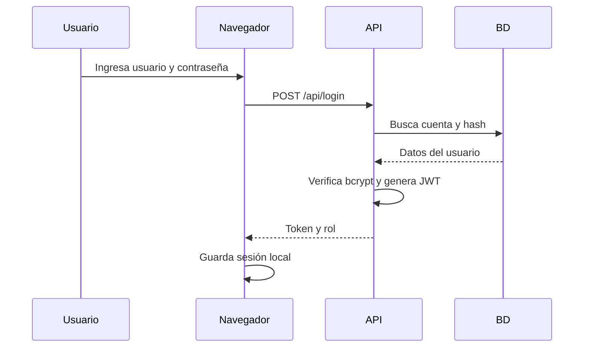
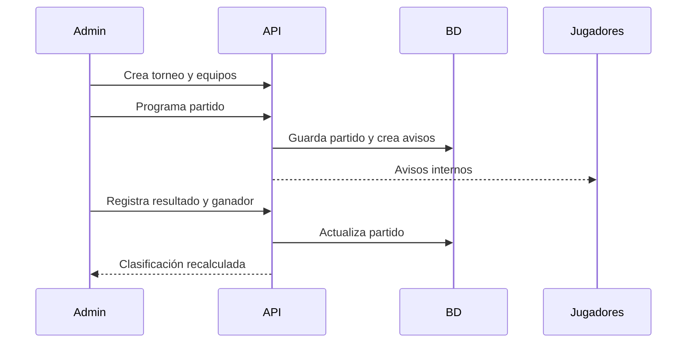
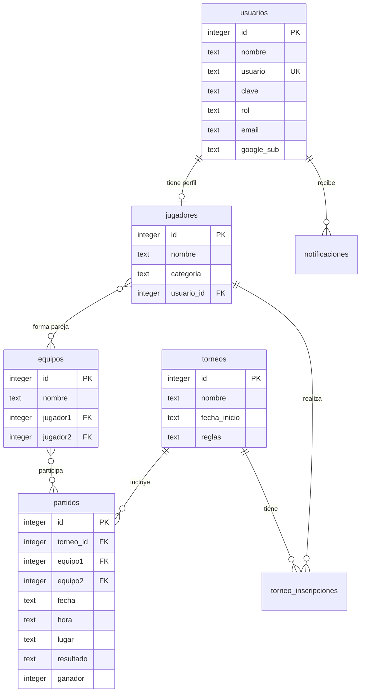

# Arquitectura del software

## Vista general

## Componentes

- **`public/index.html`**: interfaz de usuario, navegación por roles y llamadas HTTP.
- **`server.js`**: rutas HTTP, validaciones, autenticación, autorización y reglas de negocio.
- **`database.js`**: esquema, migraciones básicas y adaptador compatible con SQLite/PostgreSQL.
- **Base de datos**: información persistente de usuarios, jugadores, equipos, torneos, partidos e inscripciones.
- **Google OAuth**: autenticación opcional mediante el proveedor.
- **SMTP**: entrega opcional de inscripciones y avisos por correo.

## Flujo de inicio de sesión

## Flujo de un partido

## Modelo de datos

